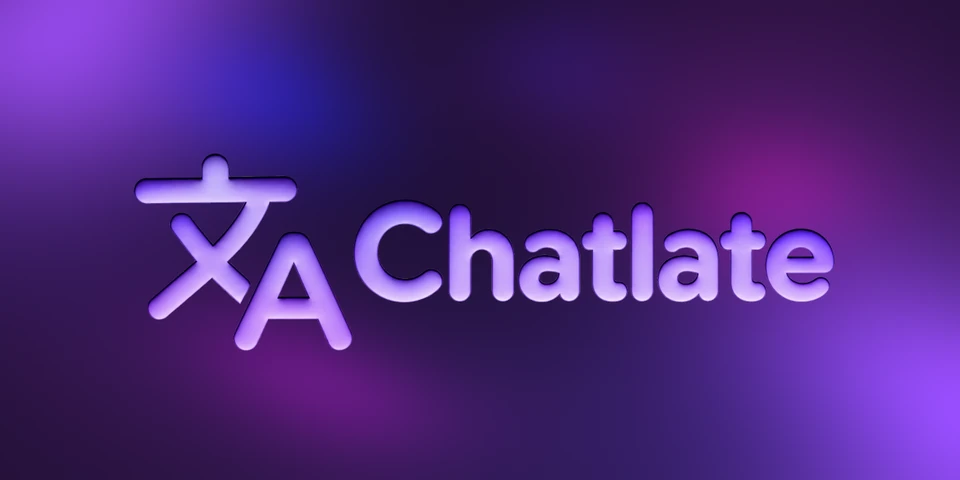

# Chatlate

Chat translation for Inugram, with Telegram formatting preserved.

## Features

- Translate messages and entire chats without Telegram Premium.
- Preserve formatting, links, quotes and spoilers while keeping code, usernames and custom emoji unchanged.
- Drag providers into your preferred order and enable or disable them individually.
- Automatically try the next enabled provider when a service is temporarily unavailable.
- Test enabled providers and see their connection status and response time.
- Read release notes and version history in the plugin.
- English and Turkish interface, following Inugram's language by default.

## Currently supported providers

**Google · Yandex**

These use unofficial public endpoints. Availability and rate limits may change.

## Installation

1. Download the `.inu.js` installation file from [Releases](https://github.com/berkmirsatk/Chatlate/releases).
2. In Inugram, open **Settings → Plugins** and import the file.
3. Enable Chatlate and review its permissions.
4. Enable chat translation in Inugram. Google is selected automatically; change priorities in Chatlate settings.

Use an Inugram version that supports plugins, custom translation providers and the native bridge. Whole-chat translation follows the app's excluded-language and chat eligibility settings. Update an existing installation without uninstalling it to keep preferences.

## Privacy

Text is sent to the selected translation service. Enabled backups may receive the same text if an earlier service fails. There is no telemetry or persistent message log. Preferences are stored locally; translation caches are bounded and kept in memory.

Peer access supplies the community channel/group's public name and photo. Clipboard access only copies the donation address after a tap. Native permissions support settings integration. See [SECURITY.md](SECURITY.md) for details and limits.

## Community and support

[Plumgins](https://t.me/Plumgins) · [Plumgins Chat](https://t.me/PlumginsChat) · [Buy Me a Coffee](https://buymeacoffee.com/berkmirsatk)

Tap the settings banner for community links, version history and support options, including USDT on TON.

## Development

```sh
npm ci
npm run package
```

Source modules remain readable; the build produces one installable `.inu.js` file. See [DEVELOPING.md](DEVELOPING.md), [CHANGELOG.md](CHANGELOG.md) and the [release checklist](docs/RELEASE_CHECKLIST.md).

Chatlate checks this repository's latest public Release when settings opens. Newer versions appear below the banner; installation starts only after a tap and uses Inugram's normal confirmation screen. Checks send no translation text or account token. While the repository is private or has no public Release, no update is offered.

## License

[GNU GPLv3](LICENSE); see [third-party notices](THIRD_PARTY_NOTICES.md) for included marks. © 2026 [real4265726B](https://t.me/real4265726B). Chatlate combines “Chat” and “Translate”.
